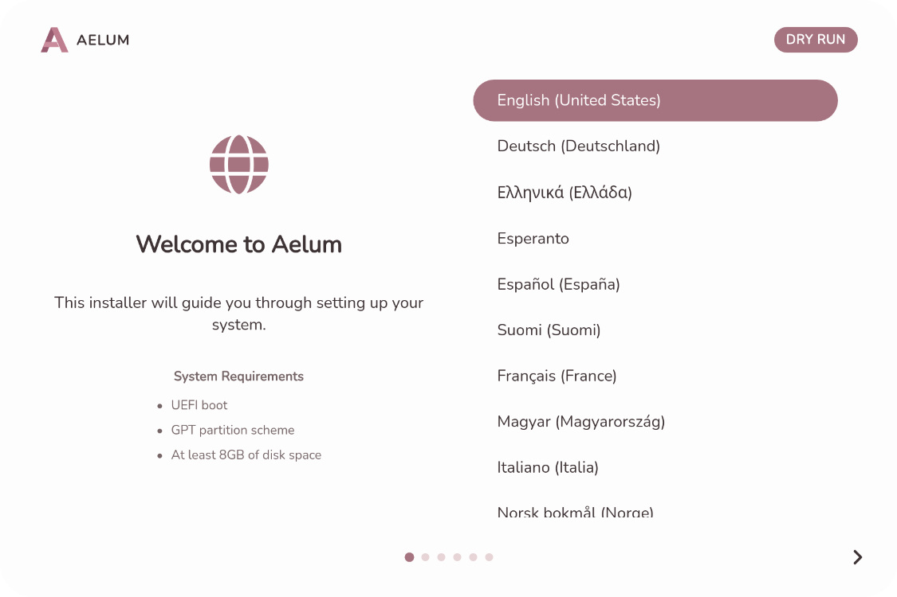

# Aelum Installer

A graphical installer for [Aelum](https://github.com/aelum-dev/live-iso), an Arch Linux distro. The install works fully offline — no network needed to install it. Built with [Wails v2](https://wails.io/) (Go + Svelte 5).

Just boot the ISO and run the installer — a few clicks in the GUI, no terminal or network needed to install.




## Features

- **6 step wizard** — pick a language, create your user, choose a disk, confirm, and watch it install.
- **ext4 or btrfs** — btrfs comes with a sensible automatic subvolume layout.
- **Configured desktop** — Hyprland + Dux Shell, greetd login, Kitty terminal, Firefox, and PipeWire audio, all set up for you.
- **Fast, quiet boot** — Plymouth boot splash

## Language selection

The first thing you'll pick is your language — there are 28 to choose from. This sets the installer's own UI language, and it also chooses your system locale and the mirror country. The mirror country just configures your installed system's pacman mirror list for future online updates — the install itself pulls packages from the ISO's embedded offline repo, not from that mirror. Note that not all 28 languages are fully translated in the Dux Shell desktop yet — you can always change the desktop language later in Dux Shell settings.

## Choosing a disk and partition mode

On the *Disk Selection* step you pick **which disk** to install onto and **how** to lay out its partitions. There are two modes:

- **Automatic** (recommended) — the installer uses the whole disk and sets up the partitions for you. It creates a small boot partition and a root partition, then formats them as either **ext4** or **btrfs** (choose your filesystem with the toggle at the top). This is what most people want: pick a disk, pick a filesystem, and go. Everything else is handled automatically.
- **Manual** — you decide exactly which partitions exist and what each one is for. Use this if you're **dual-booting** (keeping another operating system and its files intact) or want a custom layout. See the plain-language guide below.

You can switch between the two modes with the **Automatic / Manual** toggle at the top of the page. Automatic mode works on any empty or whole disk; Manual mode needs a disk that already has partitions (or that you create on this screen) and a **GPT** partition table — automatic mode rewrites an older MBR table for you.

Two more toggles sit under the filesystem pills:

- **Encrypt** — LUKS2-encrypts the root partition; you are asked for a passphrase, which you enter at every boot.
- **LVM** — puts the root on an LVM logical volume. With ext4 you also get a separate `/home` volume; with btrfs everything stays on one volume's subvolumes. Both toggles can be on at once: encryption always sits *below* LVM, so the single physical volume is encrypted.

### Manual partition mode

Automatic mode erases the whole disk. Manual mode only writes to the two partitions you designate — **Boot** and **System** — and both are always formatted. Every other partition (your other operating system, documents, photos) is left exactly as it is. If you dual-boot, give Aelum its **own** Boot partition and its **own** System partition; never point Boot at another operating system's ESP.

Manual mode writes partitions with `sgdisk`, which only saves changes to a GPT, so the disk must already use a GPT table or have no table at all (the installer then creates one). A disk that still uses an MBR table is refused before anything on it is touched — use automatic mode there, since it clears the table and writes a GPT in its place.

Here's how to use it, step by step:

1. **Pick a disk.** In manual mode the screen first asks you to select a disk — click the one you want to install into. (You can't use manual mode until a disk is chosen.)
2. **Look at the list of partitions.** The disk already comes with some partitions (from a previous install, or another operating system). You'll see each one's name, its size, and a **Type** dropdown.
3. **Label two of them.** Use the **Type** dropdown on each partition to give it a role:
   - **Boot** — mark exactly **one** partition as this. It's the small boot partition the system needs to start up. It is always formatted as FAT32 and must be at least 512 MiB, so choose a dedicated partition (new, or an existing one you are willing to erase) — never another OS's ESP.
   - **System** — mark exactly **one** partition as this. It becomes your main Arch Linux install (your home files and programs live here).
   - **Preserve** — this is the default. It means "leave this one alone." Keep every other partition on this setting so your other operating system and personal files stay untouched.
   - Tip: assign **Boot** first, then **Root (System)**. You never have to type in mount points — the installer assigns them for you.
4. **Add partitions (optional).** If the disk has free space and you want a new partition, drag the slider (or type a size) to pick how big it should be, tick **Use remaining** to fill all the free space, then press **+ Add**. A brand-new partition starts as *Preserve* — set its Type like any other.
5. **Delete partitions (optional).** If there's a partition you no longer need, use the delete (🗑) button on its row. This only stages the removal — it takes effect at install time, so you can cancel beforehand with no changes.
6. **Finish.** Once exactly one **Boot** and one **System** are marked, **Next** becomes available. Both are formatted (Boot as FAT32, System with the filesystem you chose), and every *Preserve* partition is left exactly as it was found.

> If you're not sure — or this disk holds nothing you need to keep — just stay in **Automatic** mode. It's faster and safer for a fresh install.

## Getting started with building

1. Clone this repo and the [Aelum](https://github.com/aelum-dev/live-iso) live-ISO repo (side by side, e.g. `~/Projects/Aelum-Installer` and `~/Projects/Aelum`).
2. Build the installer (outputs `build/bin/aelum-installer` and `build/bin/aelum-installer-cli`):

   ```bash
   ./build.sh
   ```

3. Copy both binaries into the Aelum repo's airootfs so they're included when the ISO is rebuilt:

   ```bash
   cp build/bin/aelum-installer build/bin/aelum-installer-cli ~/Projects/Aelum/airootfs/usr/local/bin/
   ```

   `build.sh` can also do this for you with `BIN_DIR`, e.g.:

   ```bash
   BIN_DIR=~/Projects/Aelum/airootfs/usr/local/bin ./build.sh
   ```

4. Build the live ISO from the Aelum repo (this bakes the installer into the airootfs). The resulting ISO is written to `output/`.
5. Flash the ISO to a USB drive (or [Ventoy](https://www.ventoy.io/)), boot from it, and let the installer launch automatically.
6. Follow the wizard: choose your language, create your account, select your disk, and confirm.

The install runs entirely from the live ISO and needs no internet. (After install, your system is a normal Arch machine and connects to the internet like any other.)

## Running from the command line

Prefer headless or scripted installs? The installer also ships a CLI:

```bash
# GUI
sudo ./build/bin/aelum-installer

# CLI — full install (you'll be prompted for your password)
sudo ./build/bin/aelum-installer-cli --install /dev/vda

# CLI — btrfs root instead of ext4
sudo ./build/bin/aelum-installer-cli --install /dev/vda --filesystem btrfs

# CLI — LUKS2 encryption, with LVM on top of it
sudo ./build/bin/aelum-installer-cli --install /dev/vda --luks --lvm
```

## Testing

The frontend has Playwright **end-to-end tests** that drive the real Wails app (Go backend + Svelte UI together) — not a mock. They run the wizard, manual partitioning, and the full install flow against `wails dev` in dry-run mode with synthetic disks, so no real disk is touched.

```bash
cd frontend
npm install
npm run e2e:install      # one-time: downloads Playwright's Chromium
npm run e2e              # run the suite (headless)
npm run e2e:headed       # visible browser, handy for debugging
npm run e2e:report       # open the HTML report after a run
```

On headless CI, wrap the run in `xvfb-run` and install the browser system deps (`npx playwright install-deps chromium` needs sudo). The [`playwright.config.ts`](./frontend/playwright.config.ts) auto-starts `wails dev` for you, so you don't need to launch it manually. See [frontend/e2e/README.md](./frontend/e2e/README.md) for the full details (what's covered, dry-run env vars, CI setup).

## Want to build or contribute?

Head over to [AGENTS.md](./AGENTS.md) for architecture details and conventions,
[CONTRIBUTING.md](./CONTRIBUTING.md) for how to contribute, and
[TROUBLESHOOTING.md](./TROUBLESHOOTING.md) if something goes wrong.

---

GPL-3.0 — see [LICENSE](./LICENSE).
